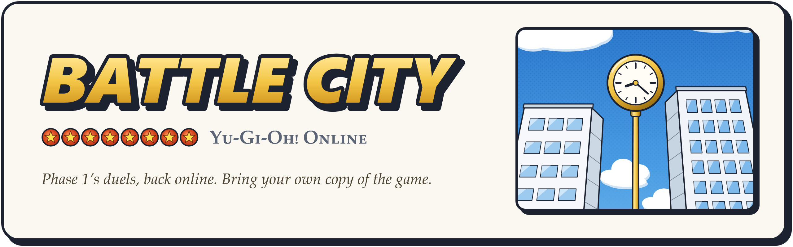
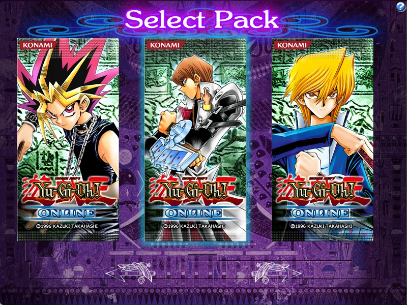
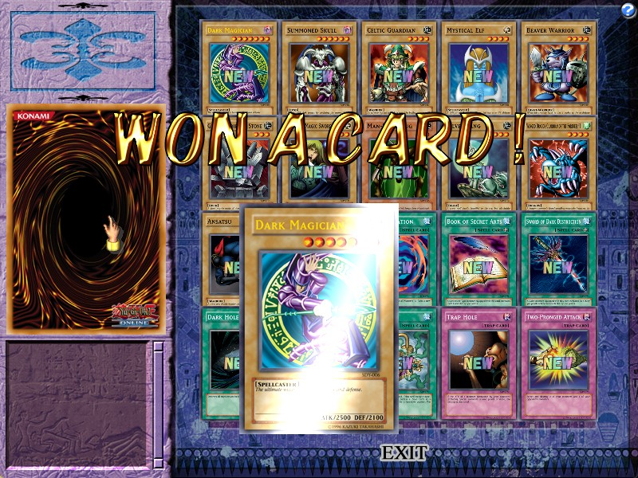
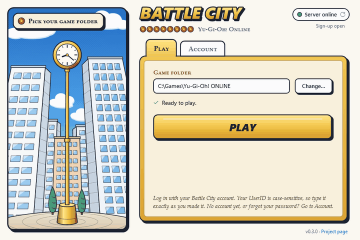

<p align="center">
  
</p>

<p align="center">
  <b>It's time to duel!</b> Yu-Gi-Oh! Online Phase 1 went offline long ago.<br>
  Battle City, a fan-made server, brings its online play back, and this launcher takes your copy of
  the game there.
</p>

<p align="center">
  
  
  
  <a href="LICENSE"></a>
</p>

<p align="center">
  
  
</p>

<p align="center">
  <a href="https://github.com/I-TD-I9/Battle-City-Launcher/releases/latest"></a>
</p>

## Getting started

1. You need Windows 10 or 11, 64-bit, and Yu-Gi-Oh! ONLINE, the February 2006 version
   (`Ver.060110.00`), unpacked anywhere. The launcher never changes your game folder.
2. [Download the launcher](https://github.com/I-TD-I9/Battle-City-Launcher/releases/latest) and run
   it. If Windows says it doesn't recognise the app, click **More info**, then **Run anyway**.
3. Click **Change…** and pick your game folder.
4. Make your account under **Account**. You'll get a code by email to finish it.
5. Click **Play** and log in with your new account.

<p align="center">
  
</p>

## Good to know

- Your UserID is case-sensitive.
- One account per email address. Forgot your password? Set a new one under **Account**.

<p align="center"><b>See you in Battle City!</b></p>

## Building it yourself

With the .NET 10 SDK on Windows:

```
dotnet publish src/BattleCity.Launcher -c Release -o publish
```

## License

GPL-3.0. Yu-Gi-Oh! is a trademark of its owners; this project isn't affiliated with or endorsed
by Konami.
